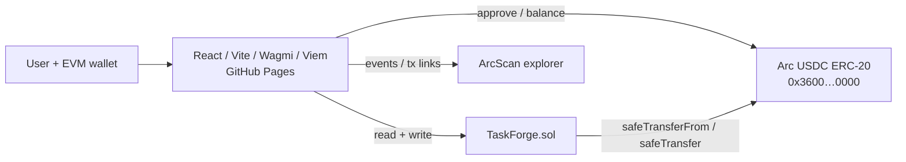

# ⚒ Task Forge

Onchain task marketplace on **Arc Testnet**. Creators escrow USDC rewards, contributors submit work (a description plus a GitHub issue/PR/other URL), the creator accepts one submission, and the contributor withdraws the reward. Tasks are general-purpose (development, frontend, smart contracts, docs, research, design, other).

> Testnet MVP. The contract has **not been audited**. Passing tests does not prove it is secure. Do not use it with real funds.

## Architecture



No backend, database, or indexer: the frontend reads contract state and events directly from the Arc RPC.

### Task states

```
Open ──acceptSubmission (creator)──▶ Accepted ──withdrawReward (contributor)──▶ Completed
  └──cancelTask (creator, see rules)──▶ Cancelled
```

`Expired` is derived (Open and past deadline), not stored: it only blocks new submissions.

| Action | Who | When |
|---|---|---|
| `createTask` | anyone | valid inputs, USDC approved; escrows reward |
| `submitWork` | not the creator, once per task | Open and before deadline |
| `acceptSubmission` | creator | Open; submission must belong to this task. Allowed after the deadline |
| `withdrawReward` | accepted contributor | Accepted; pays exactly once |
| `cancelTask` | creator | Open and (no submissions **or** deadline + 7 days passed with none accepted) |

### Financial invariants

1. `USDC.balanceOf(TaskForge) >= totalEscrowed` (fuzz-tested), where `totalEscrowed` is the sum of rewards of Open and Accepted tasks.
2. A task's reward leaves the contract at most once (`withdrawReward` or `cancelTask`, never both: terminal states).
3. Accepted tasks cannot be cancelled or expire away, so an accepted contributor's reward is always claimable.
4. Refunds only ever return the cancelled task's own reward, never other tasks' funds.
5. Fee-on-transfer tokens are rejected so escrow always equals the recorded reward.

## Arc Testnet

| | |
|---|---|
| Chain ID | `5042002` |
| RPC | `https://rpc.testnet.arc.network` |
| Explorer | `https://testnet.arcscan.app` |
| Faucet | `https://faucet.circle.com` |
| USDC (ERC-20 interface, **6 decimals**) | `0x3600000000000000000000000000000000000000` |

Values were checked against docs.arc.io when this was built. Re-verify before deploying. Arc's native gas is also USDC (18 decimals natively); the contract only uses the 6-decimal ERC-20 interface.

## Setup

Requirements: [Foundry](https://book.getfoundry.sh/getting-started/installation), Node 20+.

```bash
git clone --recurse-submodules <your-repo-url> && cd task-forge
# if you forgot --recurse-submodules:  git submodule update --init --recursive
cd frontend && npm ci && cd ..
```

### Test contracts

```bash
cd contracts
forge fmt --check
forge build
forge test -vvv
```

Tests use mock tokens and never touch a live RPC.

### Deploy to Arc Testnet

```bash
cp .env.example .env        # fill in PRIVATE_KEY (a throwaway testnet key!). .env is git-ignored.
set -a && source .env && set +a
cd contracts
forge script script/DeployTaskForge.s.sol:DeployTaskForge \
  --rpc-url "$ARC_RPC_URL" --broadcast
```

The script aborts unless `block.chainid == 5042002` and the token at `USDC_ADDRESS` has 6 decimals. Fund the deployer from the faucet first (gas is paid in USDC).

After a successful deploy, copy the contract address, deploy tx hash and block number into `deployments/arc-testnet.json`, and check the contract on ArcScan.

### Run the frontend locally

```bash
cd frontend
cp .env.example .env.local
# set VITE_TASKFORGE_ADDRESS=<deployed address> and VITE_DEPLOY_BLOCK=<deploy block>
npm run dev
```

Without a configured address the app shows a banner and no task data (it never shows mock data as chain data).

### Publish to GitHub Pages

1. Push to GitHub (default branch `main`).
2. **Settings → Pages → Source: GitHub Actions**.
3. **Settings → Secrets and variables → Actions → Variables**: add `VITE_TASKFORGE_ADDRESS`, `VITE_DEPLOY_BLOCK` (and optionally `VITE_USDC_ADDRESS`). These are public values, not secrets.
4. Push to `main` (or run the *deploy-frontend* workflow). The site appears at `https://YOUR_GITHUB_USERNAME.github.io/YOUR_REPOSITORY_NAME/`.

The workflow only builds and publishes the static site; it never deploys contracts.

## Layout

```
contracts/src/TaskForge.sol        contracts/test/TaskForge.t.sol    contracts/script/DeployTaskForge.s.sol
frontend/src/                      deployments/arc-testnet.json      .github/workflows/{test,deploy-frontend}.yml
```

If you change the contract, regenerate the ABI: `cd contracts && forge inspect TaskForge abi --json`, then update `frontend/src/abi.ts`.

## Known limitations (MVP)

- Frontend lists tasks by paging through contract state (fine for hundreds of tasks, not thousands) and loads history via `getLogs` from `VITE_DEPLOY_BLOCK`; the RPC may limit log ranges.
- Reward token is fixed at deployment (one USDC token per deployment). Non-standard tokens (fee-on-transfer, rebasing) are unsupported.
- Creators choose winners; there is no dispute resolution.
